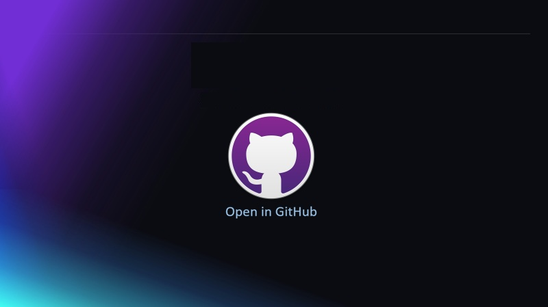

This exercise is provided as a GitHub Skill.

Before you begin, make sure you have:

- A GitHub account with access to GitHub Copilot.
- A public copy of the exercise repository.
- Basic familiarity with GitHub repositories, branches, and pull requests.
- Comfort editing YAML and Markdown files.

> **IMPORTANT**: This exercise is designed for public repository copies. If you copy the exercise as a private repository, token setup may require additional account or organization policy configuration.

{:target="_blank"}

